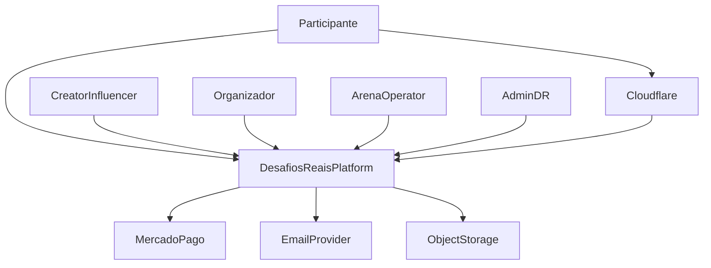
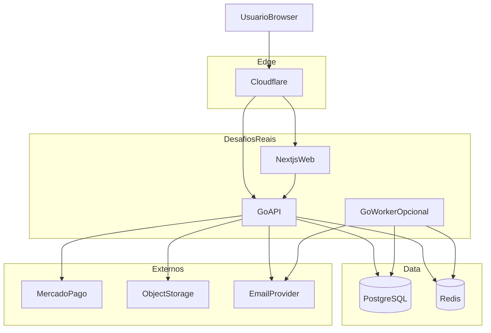
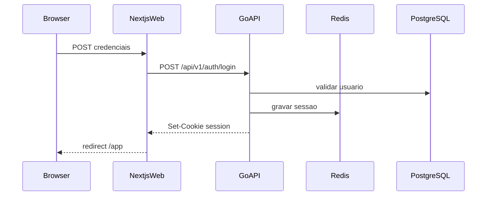
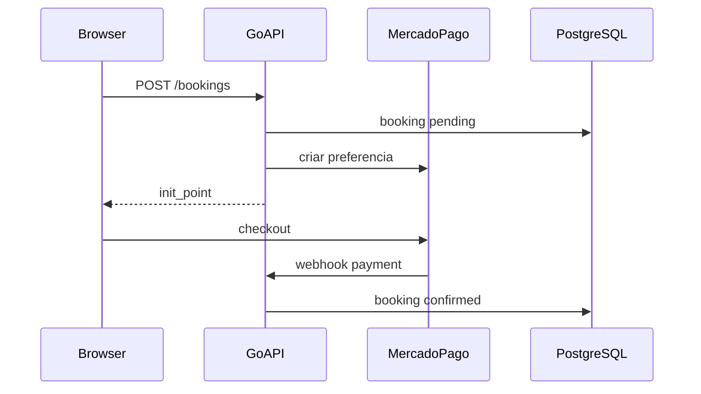

# DESAFIOS REAIS — C4 (Contexto e Containers)

**Versão:** 1.0

---

## 1. Nível 1 — Contexto

### Pessoas

| Ator | Descrição |
|------|-----------|
| Participante | Compete, reserva, consulta rankings |
| Creator | Publica confrontos e convites |
| Organizador | Gerencia desafios/eventos e valida resultados |
| Arena Operator | Opera SMK: slots, check-in, baterias |
| Admin | Configura plataforma, roles, flags |

### Sistemas externos

| Sistema | Função |
|---------|--------|
| Mercado Pago | Checkout de serviços comerciais |
| Email Provider | Transacional (recovery, confirmações) |
| Object Storage | Imagens e mídia |
| Cloudflare | DNS, TLS, WAF/CDN |

---

## 2. Nível 2 — Containers

### Containers

| Container | Tecnologia | Responsabilidade |
|-----------|------------|------------------|
| NextjsWeb | Next.js, React, TS, Tailwind | UI, SEO, formulários, BFF mínimo |
| GoAPI | Go, chi/echo, sqlc | REST `/api/v1`, auth, domínio |
| GoWorker | Go (mesmo binário ou separado) | Jobs async: email, recalc ranking |
| PostgreSQL | 16+ | Persistência |
| Redis | 7+ | Session, rate limit, cache, fila |

No MVP o worker pode rodar no mesmo processo via goroutines + Redis list.

---

## 3. Fluxos principais (containers)

### Login

### Reserva + pagamento

---

## 4. Nível 3 (resumo) — módulos dentro da GoAPI

Ver `docs/backend-modules.md`. Principais: Identity, Users, Challenges, Arenas, Bookings, Results, Rankings, Payments, Admin, Audit.
