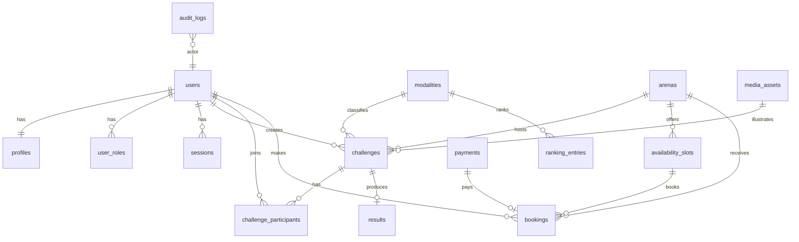

# DESAFIOS REAIS — Modelo de Dados PostgreSQL

**Versão:** 1.0  
**Convenções:** `uuid` PKs, `timestamptz`, `snake_case`, soft flags `is_demo`

---

## 1. Diagrama ER (núcleo MVP)

---

## 2. Tabelas

### users
| Coluna | Tipo | Notas |
|--------|------|-------|
| id | uuid PK | |
| email | citext UNIQUE | |
| password_hash | text | |
| email_verified_at | timestamptz NULL | |
| status | text | `active`, `suspended`, `deleted` |
| is_demo | boolean | default false |
| created_at / updated_at | timestamptz | |

### profiles
| Coluna | Tipo | Notas |
|--------|------|-------|
| user_id | uuid PK/FK | |
| display_name | text | |
| username | citext UNIQUE | |
| bio | text | |
| city | text | |
| avatar_asset_id | uuid NULL | |
| birthdate | date NULL | LGPD / menores |
| parental_consent_at | timestamptz NULL | |

### user_roles
| Coluna | Tipo | Notas |
|--------|------|-------|
| user_id | uuid FK | |
| role | text | participant, creator, organizer, arena_operator, admin |
| granted_at | timestamptz | |
| granted_by | uuid NULL | |
| PK | (user_id, role) | |

### sessions
| Coluna | Tipo | Notas |
|--------|------|-------|
| id | uuid PK | |
| user_id | uuid FK | |
| token_hash | text UNIQUE | |
| expires_at | timestamptz | |
| revoked_at | timestamptz NULL | |
| user_agent / ip | text | opcional |

### modalities
| Coluna | Tipo | Notas |
|--------|------|-------|
| id | uuid PK | |
| slug | text UNIQUE | `super-mountain-kart`, `gravity-kart` |
| name | text | |
| description | text | |
| is_active | boolean | MVP: só kart/gravity true |
| scoring_config | jsonb | regras de pontuação |
| sort_order | int | |

### arenas
| Coluna | Tipo | Notas |
|--------|------|-------|
| id | uuid PK | |
| slug | text UNIQUE | `super-mountain-kart` |
| name | text | |
| description | text | |
| address_json | jsonb | |
| timezone | text | `America/Sao_Paulo` |
| is_published | boolean | MVP: só SMK |
| capacity_default | int | |
| logo_asset_id | uuid NULL | |

### arena_modalities
| Coluna | Tipo | Notas |
|--------|------|-------|
| arena_id | uuid | |
| modality_id | uuid | |
| PK | (arena_id, modality_id) | |

### challenges
| Coluna | Tipo | Notas |
|--------|------|-------|
| id | uuid PK | |
| slug | text UNIQUE | |
| title | text | |
| description | text | |
| modality_id | uuid FK | |
| arena_id | uuid FK | |
| created_by | uuid FK | |
| competition_type | text | `one_vs_one`, `team`, `individual`, `tournament`, `open` |
| status | text | draft, pending_approval, published, in_progress, completed, cancelled, disputed |
| regulation | text | |
| capacity | int | |
| starts_at / ends_at | timestamptz | |
| cover_asset_id | uuid NULL | |
| is_demo | boolean | |
| created_at / updated_at | timestamptz | |

Índices: `(status, starts_at)`, `(modality_id, status)`, `(arena_id, starts_at)`.

### challenge_participants
| Coluna | Tipo | Notas |
|--------|------|-------|
| id | uuid PK | |
| challenge_id | uuid FK | |
| user_id | uuid FK | |
| team_name | text NULL | |
| status | text | invited, confirmed, declined, cancelled, checked_in |
| invited_by | uuid NULL | |
| UNIQUE | (challenge_id, user_id) | |

### availability_slots
| Coluna | Tipo | Notas |
|--------|------|-------|
| id | uuid PK | |
| arena_id | uuid FK | |
| modality_id | uuid FK | |
| starts_at / ends_at | timestamptz | |
| capacity | int | |
| price_cents | int | BRL |
| status | text | open, closed |

### bookings
| Coluna | Tipo | Notas |
|--------|------|-------|
| id | uuid PK | |
| user_id | uuid FK | |
| arena_id | uuid FK | |
| slot_id | uuid FK NULL | |
| challenge_id | uuid FK NULL | inscrição paga ligada |
| status | text | pending_payment, confirmed, cancelled, checked_in, completed, refunded |
| amount_cents | int | |
| currency | text | `BRL` |
| mp_preference_id | text NULL | |
| mp_payment_id | text NULL | |
| created_at / updated_at | timestamptz | |

### payments
| Coluna | Tipo | Notas |
|--------|------|-------|
| id | uuid PK | |
| booking_id | uuid FK | |
| provider | text | `mercadopago` |
| provider_payment_id | text UNIQUE | |
| status | text | |
| raw_payload | jsonb | |
| created_at | timestamptz | |

### results
| Coluna | Tipo | Notas |
|--------|------|-------|
| id | uuid PK | |
| challenge_id | uuid UNIQUE FK | |
| payload | jsonb | posições, tempos, notas |
| validated_by | uuid FK | |
| validated_at | timestamptz | |
| status | text | draft, validated, disputed |

### ranking_entries
| Coluna | Tipo | Notas |
|--------|------|-------|
| id | uuid PK | |
| modality_id | uuid FK | NULL = geral |
| season | text | ex. `2026` |
| user_id | uuid FK | |
| points | int | |
| wins | int | |
| participations | int | |
| rank_position | int | |
| UNIQUE | (modality_id, season, user_id) | |

### media_assets
| Coluna | Tipo | Notas |
|--------|------|-------|
| id | uuid PK | |
| owner_user_id | uuid NULL | |
| bucket_key | text | |
| content_type | text | |
| bytes | bigint | |
| created_at | timestamptz | |

### feature_flags
| Coluna | Tipo | Notas |
|--------|------|-------|
| key | text PK | `payments.p2p_prizes` |
| enabled | boolean | |
| metadata | jsonb | |

### audit_logs
| Coluna | Tipo | Notas |
|--------|------|-------|
| id | uuid PK | |
| actor_user_id | uuid NULL | |
| action | text | |
| entity_type / entity_id | text | |
| payload | jsonb | |
| created_at | timestamptz | |

### notifications
| Coluna | Tipo | Notas |
|--------|------|-------|
| id | uuid PK | |
| user_id | uuid FK | |
| channel | text | in_app, email |
| type | text | |
| payload | jsonb | |
| read_at | timestamptz NULL | |
| created_at | timestamptz | |

---

## 3. Estados derivados (não persistir como status)

Para challenges `published`:
- **scheduled:** `starts_at > now()`
- **open:** `confirmed_count < capacity`
- **full:** `confirmed_count >= capacity`

`confirmed_count` = count de `challenge_participants` com status `confirmed` ou `checked_in`.

---

## 4. Seed MVP

- Arena: Super Mountain Kart (`is_published = true`)
- Modalidades ativas: `super-mountain-kart`, `gravity-kart`
- Flag: `payments.p2p_prizes = false`
- Usuário admin criado via env bootstrap (sem senha no repo)
- Dados demo com `is_demo = true`
