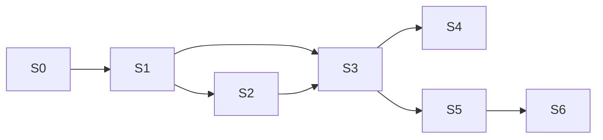

# DESAFIOS REAIS — Roadmap Técnico (Sprints)

**Versão:** 1.0  
**Cadência sugerida:** 1–2 semanas por sprint  
**Pré-requisito:** artefactos em `docs/` concluídos

---

## S0 — Foundation repo

**Entrega**
- Monorepo `apps/web`, `apps/api`, `packages/design-tokens`
- `docker-compose` (Postgres, Redis)
- `.env.example`, README, CI lint/test skeleton
- Health endpoint API
- Tokens CSS + landing shell mínima

**DoD:** `docker compose up` + API `/healthz` + web home renderiza.

---

## S1 — Identity & Admin básico

**Entrega**
- Migrations: users, profiles, user_roles, sessions, audit_logs, feature_flags
- Register / login / logout / me
- RBAC middleware
- Perfil editável + página pública username
- Admin: listar users, grant roles
- Seed admin via env

**DoD:** fluxo auth E2E local; admin concede `creator`.

---

## S2 — Landing & conteúdo institucional

**Entrega**
- Home completa (hero brand, seções, CTAs)
- Sobre, Como funciona, Arena SMK, Modalidades, Contato
- SEO metadata, robots, sitemap
- Design system: Header, Footer, Button, Section layouts

**DoD:** Lighthouse mobile razoável; rotas marketing no ar.

---

## S3 — Challenges core

**Entrega**
- Migrations modalities, arenas, challenges, media_assets
- Seed SMK + kart/gravity
- CRUD desafios + máquina de estados
- Página pública `/desafios/[slug]`
- Admin aprovação `pending_approval`

**DoD:** creator cria e publica (ou envia aprovação); página pública acessível.

---

## S4 — Marketplace & participação

**Entrega**
- Listagem + filtros
- Convites / join / capacity
- Calendário pessoal
- Notificações in-app básicas + email enqueue

**DoD:** dois users completam invite → confirmed; marketplace filtra.

---

## S5 — Bookings & Mercado Pago

**Entrega**
- availability_slots, bookings, payments
- BookingWidget + checkout
- Webhook idempotente
- Minhas reservas + cancelamento

**DoD:** pagamento sandbox confirma booking; flag P2P continua off.

---

## S6 — Ops, resultados & ranking

**Entrega**
- Check-in ops
- Results validate
- Ranking por modalidade + UI
- Relatórios admin básicos / KPIs counters

**DoD:** desafio completed atualiza ranking; check-in registrado.

---

## S7 — Community

**Entrega:** followers, perfis públicos enriquecidos, influenciadores.

## S8 — Growth & gamificação

**Entrega:** referral, views/shares, achievements, creator stats.

## S9 — Multi-arena UI

**Entrega:** seed 2ª arena, API arenas CRUD/publish, `/arenas`, filtros marketplace/reservas.

## S10 — Media & live hub

**Entrega**
- Extensão `media_assets` (purpose/status) + `live_streams`
- Upload local autenticado (jpg/png/webp ≤5MB) + `GET /media/{id}`
- Capa de desafio (`POST .../cover`) + UI create/detail/cards
- Hub `/media` com streams demo

**DoD:** upload → cover_url nas listagens; `/api/v1/live` lista seeds.

## Pós-MVP restante

| Sprint block | Fase overview | Foco |
|--------------|---------------|------|
| S11+ | Fase 5 | Flutter, novas modalidades, patrocínios, analytics avançado |

---

## Dependências entre sprints

S2 pode paralelizar com início de S3 após S1.
